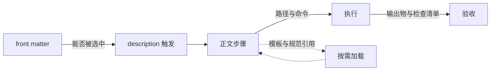

# LLM 视角文档审计与修订报告

- 日期：2026-10-26
- 范围：`skills/`、`lang-spec/`、`agent-templates/`
- 方法：自动化体检（front matter、标题层级、代码围栏、引用有效性）加人工抽读核心文档

## 一、审计模型

LLM 消费这些文档的路径可以拆成四段，任一环节失配都会导致技能无法正确触发或执行：

对应六个审查维度：

| 维度 | 核心问题 | 典型症状 |
|------|----------|----------|
| 可触发性 | 模型能否判断"何时用我" | description 只写"该技能没有执行文件" |
| 可执行性 | 步骤是否有明确命令、路径、输入输出 | 命令中 `$1`、`$2` 未定义 |
| 一致性 | 同一概念在不同文件是否同名同义 | 严重度有"高/中/低"、P0/P1/P2、红黄绿三套 |
| 无歧义 | 规则之间是否自相矛盾 | 同一文件既说模板优先又说项目优先 |
| 上下文效率 | 是否重复正文、引用是否可解析 | 模板路径含义依赖猜测 |
| 结构完整 | Markdown 是否可被稳定解析 | 代码围栏未闭合、标题跳级 |

## 二、发现的问题

### 2.1 元数据与触发

| 问题 | 位置 | 影响 |
|------|------|------|
| description 为元描述，不含触发场景 | 约 12 个 SKILL.md，如 `code-refactor`、`java-compile`、`merge-agents-md` | 模型难以判断适用时机 |
| 自定义键 `Triggers` 混入 front matter | `gdb-heap-analysis` | 触发词不在标准字段，部分工具不读取 |
| 非标准键 `origin`、`mode`、`permission` | `java-coverage`、`semble-search` | 与标准 SKILL.md 约定不一致 |
| name 与目录名不一致 | `sync-repo-docs`（name 为 `sync-repo-doc`） | 技能查找失败或重复注册 |
| description 中引号嵌套错误 | `md2pdf` | 可读性差，易被解析器误判 |

### 2.2 结构与格式

| 问题 | 位置 | 影响 |
|------|------|------|
| 无一级标题 | `sync-repo-docs` | 文档没有主题锚点 |
| 多个一级标题 | `code-detect-dup` | 结构被解析为三篇文档 |
| 一级标题与内容不符 | `java-asprof`（标题为"代码编译"） | 模型误判技能用途 |
| 起始层级为 H2 | `vbox-test-env` | 结构不完整 |
| 代码围栏未闭合 | `review.js.md` | 后续全部内容被当作代码块 |
| 围栏嵌套未升级反引号 | `review.js.md` | 内层代码块提前闭合外层 |
| 标题跳级 | `semble-search` | 目录结构异常 |
| 目录树之外的 ASCII 示意 | 未见新增违规 | 保持现状 |

### 2.3 内容矛盾

| 问题 | 位置 | 冲突点 |
|------|------|--------|
| 模板与项目 AGENTS.md 的权威冲突 | `merge-agents-md` | HARD-GATE 说模板优先，正文说项目优先 |
| 评分边界重叠 | `code-detect-problem` | 6 分与 4 分同时属于两个区间 |
| 规范自相矛盾 | `spec.rust.md` | 禁止 `expect`，示例却使用 `expect` |
| 文档声明与实际条目不符 | `lets-loop` | 声明 20 种循环模式，实际列出 11 种 |
| 输入路径与生产者不一致 | `qualitative-assessment` | 收集命令指向不存在的 `docs/problem/problem-*.md` |
| 提示词与执行方式冲突 | `long-term-task`、`requirement-collect` | 要求 todowrite，但仓库规则要求写入 `docs/todo/` |

### 2.4 可执行性

| 问题 | 位置 | 影响 |
|------|------|------|
| 命令参数未定义 | `java-asprof` | `$1`、`$2`、`$wait_time` 无来源 |
| 命令引号错误 | `ast-grep-block` | 校验命令无法直接执行 |
| 模板引用语义错误 | `code-part-modification` | "输出：templates/x.md" 把模板当产物路径 |
| 项目专属路径混入通用技能 | `sql-extract`、`ast-grep-block` | 模型可能照搬不存在的目录 |
| 失效链接与占位链接 | `ast-grep-block` | 规则库链接指向 `https://github.com/` |
| 缺少验证与完成标准 | 多个指引型技能 | 无法判断何时结束 |

### 2.5 语言规范

| 问题 | 位置 | 影响 |
|------|------|------|
| 审查规则近乎为空 | `review.rust.md` | 仅有一条提示加签名，无法执行审查 |
| 审查规则只覆盖性能 | `review.js.md` | 缺少正确性、安全、质量维度 |
| 缺少工具与优先级章节 | `review.python.md` 等 | 与其他语言审查文件结构不一致 |
| 签名版本与日期陈旧 | 7 个 review 文件 | 无法判断规则时效 |
| 构建文件缺少签名 | `ci.java.md`、`ci.kotlin.md` | 与规范文件约定不一致 |
| 构建命令与"首选 mvnd"矛盾 | `ci.java.md` | 全文使用 mvn |

### 2.6 代理模板

| 问题 | 位置 | 影响 |
|------|------|------|
| 章节集合不一致 | 8 个语言模板 | 合并时行为不可预期 |
| 仅 Java/Kotlin 有环境信息 | `AGENTS.*.md` | 其他语言缺少环境确认入口 |
| 仅 Java/Kotlin 有构建指引 | `AGENTS.*.md` | 其他语言合并后无构建命令 |
| 机器专属工具路径散落正文 | `AGENTS.java.md` | 迁移到其他机器时容易误用 |
| 缺少统一工作准则 | 全部模板 | 对最小改动、测试、日志、提交的约束不一致 |

## 三、已执行的修订

### 3.1 元数据

1. 34 个 SKILL.md 的 description 重写为"能力说明加适用场景"，并覆盖触发词。
2. `sync-repo-docs` 的 name 与目录对齐。
3. 移除 `Triggers`、`origin` 等非标准键，触发词并入 description。
4. 统一使用双引号包裹 description。

### 3.2 结构与可执行性

1. 修正 `java-asprof`、`code-detect-dup`、`sync-repo-docs`、`vbox-test-env` 的标题与层级。
2. `java-asprof` 重写为参数完整的采样流程；`java-compile`、`java-env`、`java-g2m`、`java-gen-unittest` 补齐前置条件、步骤、输出与验收。
3. `full-analysis` 补齐依赖顺序、输出物与完成标准。
4. `code-part-modification` 明确模板与产物的区别及产物路径。
5. `ast-grep-block` 修复失效链接与命令引号；`sql-extract` 去除项目专属路径。
6. 统一模板引用为 `templates/...` 并声明其相对位置；跨技能引用改为 `${AI_SPEC_ROOT}` 绝对锚点。

### 3.3 矛盾消解

1. `merge-agents-md` 建立"项目事实优先、通用规则模板优先"的权威表。
2. `code-detect-problem` 边界改为：高于 6 重构，4 至 6 用户决策，低于 4 重建。
3. `spec.rust.md` 示例改为返回 `Result`，消除与"禁止 expect"的冲突。
4. `lets-loop` 改为"循环设计模式"并按实际条目描述。
5. `qualitative-assessment` 修正输入路径与生产者一致，补充非功能评分标准。
6. `long-term-task`、`requirement-collect` 明确 todowrite 缺失时的 TODO 文件回退方式。

### 3.4 语言规范

1. 新增 `review.rust.md` 完整审查规则：严重度、工具、正确性、所有权、错误处理、并发、unsafe、性能、安全、坏味道、优先级、输出。
2. `review.js.md` 修复围栏并补充正确性、安全、质量、坏味道、优先级；`review.python.md` 补充工具与优先级。
3. 全部 review 文件增加"严重度口径"；ansi_c、cpp、java、shell 增加静态分析工具；全部增加审查输出章节。
4. `ci.java.md` 改为 mvnd 优先并补充验证与签名；`ci.kotlin.md` 补充签名。
5. 更新本次修改文件的版本与日期。

### 3.5 代理模板

1. 9 个模板统一章节：角色定位、工作准则、环境信息、环境变量、交互规则、编码规范、构建与验证。
2. 新增 5 条工作准则，覆盖读规范、最小改动、测试、日志、提交。
3. 为各语言补充环境确认方式与构建验证命令；Java 特有工具整理为表格并标注按需保留。
4. `AGENTS.blank.md` 补齐占位结构。

### 3.6 仓库约定

在 `AGENTS.md` 中补充 SKILL.md 元数据约束、正文结构约定、规范文件写作约定，并把技能表中的 `sync-repo-doc` 更正为 `sync-repo-docs`。

## 四、遗留与建议

1. 外部软链接技能（`creating-mermaid-diagrams`、`drawio-skill`、`excalidraw-diagram`、`html-ppt`、`plantuml-skill`、`ppt-master`）属于独立仓库，本次未修改；如需统一规范，应在各自仓库处理。
2. 本地未跟踪技能（`semble-search`、`memrec`、`multype2txt`）未纳入本次修订的提交范围；`semble-search` 已补一级标题与工作流标题，但其 `mode`、`permission` 键是否保留取决于宿主实现。
3. `markdownlint` 的 MD031、MD032 等在既有文档中大量存在，属于历史风格问题，本次只修复新引入或影响解析的错误；如需全量治理，建议单独提交并配置 CI。
4. 建议后续在 CI 增加三项门禁：SKILL.md front matter 校验、代码围栏配对检查、`${AI_SPEC_ROOT}` 引用存在性检查。

## 五、结论

本次修订把文档从"人类可读的操作说明"推进到"模型可判定、可执行、可验收的契约"：触发信息集中到 description，执行路径明确到命令与产物，跨文件冲突以显式权威表收敛，语言审查规则补齐到同一结构。

剩余风险主要来自外部技能与历史 Markdown 风格，不影响本次范围内的技能选择与执行。
