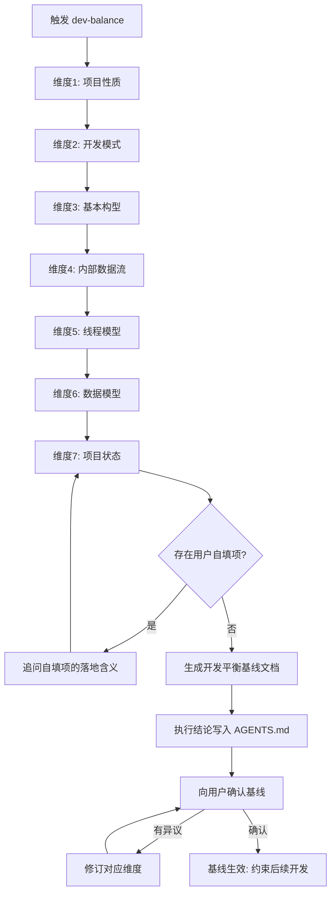

# dev-balance - 开发平衡基线

<HARD-GATE>
**强制约束：必须先询问，后动手**

1. 未完成七个维度的询问（或用户明确声明"全部按推荐"），禁止开始任何编码、重构或架构落地。
2. 每个维度必须以用户回答为准，不得以 AI 推断替代用户表态。
3. 用户选择含组合语义的选项（如"c = a+b"）时，基线须完整体现组合后的全部约束。
4. 基线文档必须落盘、且执行结论必须写入当前项目 `AGENTS.md`，方可进入开发阶段。

违反以上约束视为执行失败，必须回到询问阶段。
</HARD-GATE>

## 目的

项目的技术决策存在天然张力：吞吐与低延时、规范与速度、演进性与简单性。"平衡"不是折中，而是显式选择。本技能在开发启动前，把七个关键维度的预期固化为一份**开发平衡基线**，使后续所有编码、审查、重构有统一的取舍依据。

## 核心原则

1. **先平衡，后开发**：基线先行，编码是基线的演绎
2. **显式优于隐式**：每个维度的选择必须落盘，不允许"默认习惯"
3. **组合即约束**：组合选项意味着多套约束叠加，基线须逐条展开
4. **可审查**：后续代码审查以基线为标尺，偏离基线即为问题

## 执行流程



## Phase 1: 七维度询问

### 询问规则

- 逐维度询问，一次一题；用户要求合并时可批量询问
- 每题附简短说明，解释该维度影响什么决策
- 有 question 工具时使用 question 工具，否则以文本列出选项
- 用户回复选项字母或自填内容均视为有效回答
- 全维度回答完毕后，检查有无自填项，有则追问其落地含义

### 维度清单

| # | 维度 | 选项 | 影响 |
|---|------|------|------|
| 1 | 项目性质预期 | a. demo/实验项目；b. 生产项目；c. b+高吞吐；d. b+低延时；e. c+d；f. e+特化场景；g. 其他用户自填 | 决定质量投入、测试强度、性能预算 |
| 2 | 开发模式预期 | a. 过程式开发（一般 C/C++/Rust）；b. OO 开发（一般 C++/Rust/Java）；c. DDD 开发（一般 C++/Rust/Java）；d. 其他用户自填 | 决定代码组织单位、抽象层次、命名体系 |
| 3 | 基本构型预期 | a. MVVC/MVC；b. 六边形模型/洋葱模型；c. 混合；d. 其他用户自填 | 决定模块分层、依赖方向、目录结构 |
| 4 | 内部数据流预期 | a. Controller-Service-Dao / C-Repository-S-D；b. Event-Driven；c. 混合；d. 其他用户自填 | 决定调用链形态、耦合点、异步边界 |
| 5 | 线程模型预期 | a. Http 线程足够；b. 自建自管理线程；c. a+b；d. c+严控线程；e. d+绑核；f. d+虚拟线程；g. 其他用户自填 | 决定并发设施、锁策略、资源规划 |
| 6 | 数据模型预期 | a. pojo；b. 贫血/充血/胀血模型（需指明取哪一种）；c. DTO/DAO 全套；d. DDD；e. SoA+方法语义封装；f. 其他用户自填 | 决定对象职责、数据流转载体、序列化边界 |
| 7 | 项目状态预期 | a. 全新项目，全量构建开发；b. 待上线项目，增量开发；c. 已上线项目，增量开发；d. 其他用户自填 | 决定改动范围、回归策略、兼容性要求 |

### 各维度说明要点

**维度1 项目性质**：demo 允许欠账与硬编码；生产要求测试、监控、错误处理完备；高吞吐关注批量、池化、零拷贝；低延时关注锁竞争、分配次数、尾延迟；特化场景（如绑核、DPDK、指定硬件）需追问具体特化点。

**维度2 开发模式**：过程式以函数与数据结构为中心；OO 以类与继承/组合为核心；DDD 需明确限界上下文、聚合、领域事件的落地深度。三者与语言无强绑定，选项中的语言仅为惯例提示。

**维度3 基本构型**：MVVC/MVC 面向展示驱动；六边形/洋葱模型强调端口与适配器、依赖由外向内；混合构型须说明哪一部分用哪种构型及分界线。

**维度4 内部数据流**：分层调用是同步主链路；Event-Driven 引入事件总线/消息队列，须明确同步还是异步投递、顺序与幂等保证；混合须说明事件与直接调用的分界。

**维度5 线程模型**：a 为最简，依赖容器/框架线程池；b 为显式线程池与任务拆分；c 叠加两者；d 在 c 基础上限定线程总数、队列长度、拒绝策略；e 在 d 基础上 CPU 绑定与 NUMA 亲和；f 在 d 基础上以虚拟线程替代部分平台线程，须关注 synchronized 阻塞与载体线程配比。

**维度6 数据模型**：pojo 为无行为数据载体；贫血/充血/胀血须指明取向——贫血模型逻辑在 Service，充血模型逻辑在实体，胀血为实体承担过多职责（一般为反模式，选择时须给出理由）；DTO/DAO 全套要求每层独立载体与映射；DDD 要求实体/值对象/聚合根区分；SoA+方法语义封装要求服务接口按业务动词组织。

**维度7 项目状态**：全新项目允许全量构建，目录与基础设施可一步到位；待上线项目以增量补齐为主，改动须控制范围、保护既有功能、准备上线验证；已上线项目增量开发要求最强的回归策略与兼容性——接口与数据结构变更须向后兼容或提供迁移方案，改动最小化、可回滚。

## Phase 2: 生成基线文档

使用模板 `templates/baseline.md`，输出到 `docs/dev-balance/{yyyymmdd}-baseline.md`。

基线文档必须包含：

1. **选择摘要**：七维度的最终选项一览表
2. **组合展开**：组合选项拆解后的全部约束
3. **推导约束**：由选择推导出的开发规约（做什么、不做什么）
4. **平衡取舍**：明确记录放弃了什么、为什么
5. **自填项释义**：用户自填内容的落地解释

### 2.1 执行结论写入 AGENTS.md

问询结果的执行结论必须同步记录到当前项目 `AGENTS.md`，使后续所有 AI 会话无需重新问询即可获知基线。

写入要求：

- 位置：`AGENTS.md` 中新增独立章节 `## dev-balance 执行结论`；已存在该章节则整体更新，不重复追加
- 内容：七维度最终选项一览（维度名 + 选项字母 + 简短释义）、基线文档路径、确认时间
- 精简：AGENTS.md 只记录结论摘要，完整推导与取舍分析保留在基线文档中，两处以路径互链
- 模板：见 `templates/agents-section.md`

## Phase 3: 基线确认

向用户展示基线摘要，请求确认：

```text
开发平衡基线已生成（docs/dev-balance/{yyyymmdd}-baseline.md），摘要如下：
1. 项目性质：xxx
2. 开发模式：xxx
3. 基本构型：xxx
4. 内部数据流：xxx
5. 线程模型：xxx
6. 数据模型：xxx
7. 项目状态：xxx
执行结论已写入 AGENTS.md 的 "dev-balance 执行结论" 章节。
是否确认生效？
```

| 反馈 | 处理 |
|------|------|
| 确认 | 基线生效，进入开发 |
| 修改某维度 | 重新推导该维度相关约束，再次确认 |
| 取消 | 终止，不落盘 |

## Phase 4: 基线生效

基线生效后，作为后续工作的强制标尺：

| 场景 | 应用方式 |
|------|----------|
| 编码 | 目录结构、分层、命名、并发设施必须符合基线 |
| 代码审查 | 偏离基线即为审查发现项 |
| 局部修改 | 修改前核对是否触碰基线约束，触碰则先回到基线修订流程 |
| 重构 | 重构目标不得与基线冲突，冲突则先与用户修订基线 |
| 问题侦测 | 性能/设计问题以基线的性能预算与取舍为判定依据 |

## 异常处理

| 情况 | 处理 |
|------|------|
| 用户拒绝回答某维度 | 记录"用户放弃表态"，采用推荐选项并在文档中标注 |
| 自填项含义模糊 | 追问一次；仍模糊则按字面最窄解释落盘并标注风险 |
| 选项与现有代码冲突 | 报告冲突点，由用户裁决：改基线或改代码 |
| 用户中途变更已确认维度 | 回到 Phase 2 重新推导，重新确认 |

## 执行检查清单

**询问阶段：**

- [ ] 七维度全部询问完毕
- [ ] 组合选项已拆解确认
- [ ] 自填项已追问落地含义

**落盘阶段：**

- [ ] 基线文档已按模板生成
- [ ] 执行结论已写入 AGENTS.md 的 "dev-balance 执行结论" 章节
- [ ] 平衡取舍（放弃了什么）已显式记录
- [ ] 用户已确认基线

**生效阶段：**

- [ ] 后续开发以基线为标尺
- [ ] 偏离基线的决策已回流修订基线
