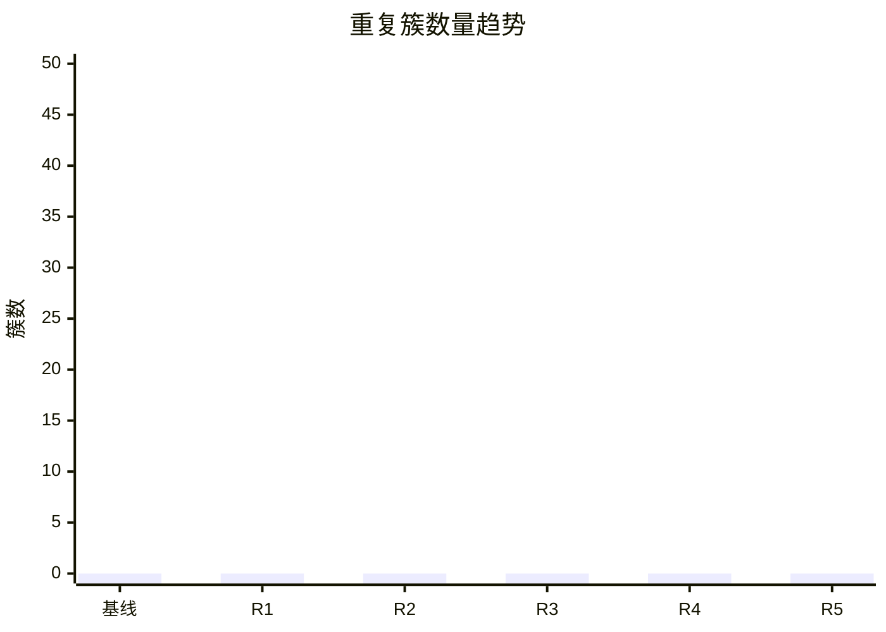

# 质量循环指标

## 基线

| 指标 | 基线值 | 目标 |
|---|---|---|
| 完全重复簇（≥N 行，排除委托模板） |  |  |
| 重复率（行） |  |  |
| 重复率（Token） |  |  |
| 测试类/用例 |  |  |
| 消除 switch/if 分派 |  |  |
| 黄金对拍一致率 |  |  |
| 构建耗时 |  |  |
| 健康分 |  |  |

## 每轮记录

| 轮次 | 目标 | 类别 | 减少簇 | 消除分派 | 黄金对拍 | 净减行 | 新增测试 | 编译 | 测试 | 回归 | 耗时 | 提交 |
|---|---|---|---|---|---|---|---|---|---|---|---|---|
| 1 |  |  |  |  |  |  |  | 通过/失败 | 通过/失败 |  |  |  |
| 2 |  |  |  |  |  |  |  |  |  |  |  |  |

## 趋势



## 健康分计算

```text
Health = 100
       - 20 × duplicateRate
       - 5  × (duplicateClusters / 10)
       - 20 × buildFailureRate
       - 10 × regressions
```
