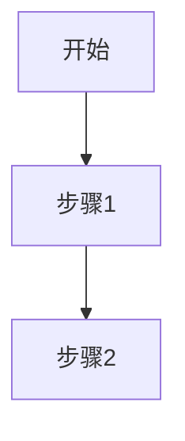
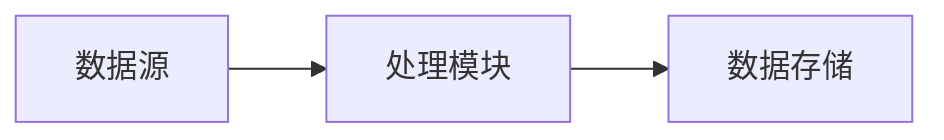

# {模块名称} 需求文档

## 模块概述

[模块简介、在系统中的定位]

## 根本需求（价值目标）

> 回答「为什么必须有这个模块/这些技术手段」。禁止把类、方法、表、消息、缓存、锁等实现形态当作需求。

### 价值目标

| 序号 | 根本需求 | 说明（业务价值/风险/合规） | 参考技术实现（非唯一，仅作证据） |
|------|----------|---------------------------|-----------------------------------|
| RN-1 | [如：数据安全持久、不丢失、可审计、可回滚] | [为什么必须] | [当前如何实现，非唯一] |
| RN-2 | [如：集群内所有节点数据视图强/最终一致] | [不一致的业务后果] | [当前如何实现，非唯一] |

### 参考技术实现 → 根本原因映射

| 参考技术实现（非唯一） | 背后的根本原因 | 代码证据 |
|--------------|----------------|----------|
| [如：写入主库→刷新缓存→通知重载] | [如：数据必须安全落地且集群一致] | [文件:行号] |

## 业务场景

### 场景列表

| 序号 | 场景名称 | 描述 | 优先级 |
|------|----------|------|--------|

### 场景详情

#### 场景1: {场景名称}

**触发条件**：[什么情况下触发]

**业务流程**：

**预期结果**：[期望的结果]

## 功能需求

### 核心功能

| 序号 | 功能名称 | 描述 | 输入 | 输出 |
|------|----------|------|------|------|

### 辅助功能

| 序号 | 功能名称 | 描述 | 输入 | 输出 |
|------|----------|------|------|------|

## 业务规则（深度挖掘）

**[必须包含完整的业务规则章节，不得省略]**

### 规则分类

| 分类 | 规则数量 | 说明 |
|------|----------|------|

### 规则详情

[详见业务规则章节模板]

## 数据需求

### 数据实体

| 实体名称 | 属性列表 | 来源 |
|----------|----------|------|

### 数据流转

## 非功能需求

### 性能要求

[性能指标]

### 安全要求

[安全要求]

## 约束条件

[业务约束、技术约束]
