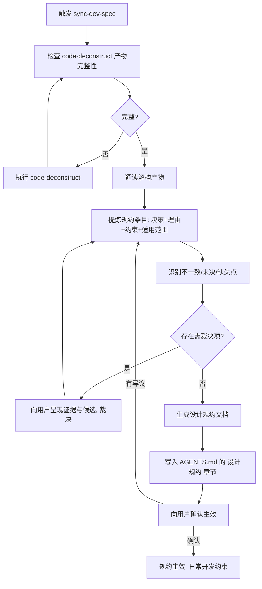

# sync-dev-spec - 设计规约同步

> 本文件中的 `templates/...` 均指本技能目录下的 `templates/` 子目录。

<HARD-GATE>
**强制约束：规约必须源于代码事实**

1. 未确认 code-deconstruct 产物完整（缺失则先执行 code-deconstruct），禁止提炼规约。
2. 每条规约必须有代码依据（引用 `docs/deconstruct/` 的具体文档），禁止凭空生成规约。
3. 不一致点与未决点必须向用户裁决，不得由 AI 擅自统一风格。
4. 规约必须写入当前项目 `AGENTS.md` 的 `## 设计规约` 章节，方可结束。

违反以上约束视为执行失败，必须回到对应阶段重做。
</HARD-GATE>

## 目的

code-deconstruct 产出的是**描述性**文档（设计是什么样），本技能将其转化为**规范性**规约（必须是什么样，偏离即违规），固化到 `AGENTS.md`，使后续所有 AI 会话的编码、审查、重构有统一标尺。规约从代码事实中提炼，不来自预设选项菜单，因此对任意形态的项目均适用。

## 核心原则

1. **事实先行**：先有 code-deconstruct 的解构产物，后有规约
2. **描述转规范**：把"用了分层架构"转写为"新增模块必须遵循 X 分层，禁止 Y"
3. **条条有据**：每条规约标注依据文档路径，可追溯、可质疑
4. **裁决归用户**：风格冲突与未决取舍由用户定夺，AI 只呈现证据与候选

## 执行流程



## Phase 1: 产物完整性检查

### 必需产物

| 产物 | 说明 |
| :--- | :--- |
| `docs/deconstruct/classes_graph.puml` | 主干类图 |
| `docs/deconstruct/core_data_flow.puml` 或 `.md` | 核心数据流 |
| `docs/deconstruct/global_design.md` | 全项目设计细节 |
| `docs/deconstruct/arch_design_summary.md` | 架构设计总结 |
| `docs/deconstruct/design_{package}/design.md` | 分模块设计（至少一个模块） |

### 条件产物

| 产物 | 条件 |
| :--- | :--- |
| `docs/deconstruct/database/`（inventory、ER 图、database_design.md） | 项目含数据库时必需 |
| `docs/deconstruct/algorithm_{package}/algorithm.md` | 存在核心算法时必需 |
| `docs/deconstruct/memory_usage.md` | 长运行或资源敏感项目应有 |
| `docs/deconstruct/network_usage.md` | 含网络通信时应有 |

### 检查处理

- 必需产物缺失：停止，先完整执行 `code-deconstruct` 技能，产物生成后重新检查
- 条件产物缺失且对应条件成立：同样回到 `code-deconstruct` 补齐
- 条件产物缺失但条件不成立：记录"该项目无此类产物"，继续
- 产物存在但内容空洞（模板占位符未填充、与代码明显不符）：视同缺失

## Phase 2: 提炼规约

### 产物到规约的映射

| 解构产物 | 提炼的规约方向 |
| :--- | :--- |
| `arch_design_summary.md` | 架构模式规约：分层形态、依赖方向、模式使用边界 |
| `global_design.md` | 全局规约：公共组件、横切关注点（日志、异常、配置）的统一方式 |
| `core_data_flow` | 数据流规约：调用链形态、禁止的跨层/反向调用、异步边界 |
| `design_{package}/design.md` | 模块规约：模块职责边界、对外接口形态、模块间依赖规则 |
| `classes_graph.puml` | 组织规约：命名体系、类的组织与可见性习惯 |
| `database/` | 数据访问规约：SQL 风格、事务边界、对象-表映射方式 |
| `algorithm_{package}/algorithm.md` | 算法实现规约：核心算法的实现方式与替换限制 |
| `memory_usage.md` | 资源规约：资源释放方式、集合与缓存使用限制 |
| `network_usage.md` | 通信规约：序列化方式、超时与重试习惯 |

### 条目格式

每条规约包含五个字段，缺一不可：

| 字段 | 内容 |
| :--- | :--- |
| 编号 | `DS-{seq}`（Design Spec） |
| 约束 | 必须 / 禁止 / 建议 + 一句话表述 |
| 理由 | 为什么代码事实支持这条约束 |
| 依据 | `docs/deconstruct/` 下的具体文档路径与章节 |
| 适用范围 | 全局 / 指定模块 / 指定场景 |

### 提炼要求

- 条目按"必须遵守 / 禁止事项 / 新增代码规约"三类组织
- 从代码归纳时保留项目特有习惯（如该项目的异常处理方式、日志规范），不套用通用最佳实践
- 通用最佳实践只在代码已有体现时才收录，代码没有的不写入
- 规约条目总数控制在 50 条以内，超出则合并或只保留高频触碰项

### 需裁决项识别

提炼过程中识别三类问题，向用户呈现证据与候选后裁决：

| 类型 | 定义 | 呈现方式 |
| :--- | :--- | :--- |
| 不一致 | 同类问题在不同模块用了不同做法 | 列出各做法及所在模块、代码量占比，给出候选统一方向 |
| 未决 | 决策在用但无明确理由（如选了某框架但无说明） | 列出现状做法，询问"固化为规约"还是"标记为待重构" |
| 缺失 | 关键环节无统一做法（各写各的） | 列出现状散点，给出候选统一方案 |

## Phase 3: 写入 AGENTS.md

### 完整规约文档

先将完整规约（含依据、理由、裁决记录）落盘到 `docs/dev-spec/design-charter.md`，使用模板 `templates/design-charter.md`。这是规约的事实源，AGENTS.md 章节与之互链。

### AGENTS.md 章节

在项目 `AGENTS.md` 写入独立章节 `## 设计规约`，使用模板 `templates/agents-section.md`：

- 已存在该章节：整体更新，不重复追加
- 内容：规约条目清单（编号 + 约束一句话表述）、规约文档路径、生效日期
- 精简：AGENTS.md 只放约束条目本身，理由与依据保留在规约文档，两处以路径互链

### 确认生效

向用户展示规约摘要与裁决结果，请求确认：

```text
设计规约已生成（docs/dev-spec/design-charter.md），共 N 条：
- 必须遵守：X 条
- 禁止事项：Y 条
- 新增代码规约：Z 条
裁决结果：{不一致/未决/缺失项的处理结论}
执行结论已写入 AGENTS.md 的 "设计规约" 章节。
是否确认生效？
```

| 反馈 | 处理 |
| :--- | :--- |
| 确认 | 规约生效 |
| 修改某条目 | 修订该条目，重新确认 |
| 取消 | 终止，清除未确认的写入 |

## Phase 4: 纳入日常开发约束

规约生效后，作为后续工作的强制标尺：

| 场景 | 应用方式 |
| :--- | :--- |
| 编码 | 新增代码必须符合"新增代码规约"与对应模块规约 |
| 代码审查 | 命中"禁止事项"即为必须修复项，偏离其他条目为发现项 |
| 局部修改 | 修改前核对是否触碰规约约束，触碰则先回到规约修订流程 |
| 重构 | 重构目标不得与规约冲突，冲突则先与用户修订规约 |
| 规约失效 | 代码演进导致某条规约不再符合事实时，重新执行本技能同步 |

### 同步机制

本技能可重复执行。以下时机应重新运行：

- 大规模重构或新模块落地后
- `docs/deconstruct/` 产物更新后
- 用户认为规约与代码事实脱节时

重跑时以现有 `AGENTS.md` 章节与规约文档为基线，只更新变化条目并记录变更历史，不推倒重写。

如前次已经执行过一轮，将前次执行的结果移动到 `docs/dev-spec/dev-spec_{YYYYMMDD}_{seq%000}` 下，然后再重新生成。其中日期为git记录中上次生成日期，如无git，则使用文件创建日期。

## 异常处理

| 情况 | 处理 |
| :--- | :--- |
| `docs/deconstruct/` 不存在 | 先执行 `code-deconstruct`，完成后再继续 |
| 解构产物与当前代码不符（产物过期） | 视同缺失，重新执行 `code-deconstruct` |
| 用户拒绝裁决某项 | 按代码中占多数的做法拟定规约，标注"默认沿用多数做法" |
| 规约条目与 AGENTS.md 既有内容冲突 | 报告冲突点，由用户裁决保留或合并 |
| 项目无数据库/无网络等条件产物 | 记录不适用，跳过对应规约方向 |

## 执行检查清单

**检查阶段：**

- [ ] code-deconstruct 必需产物齐全且非空洞
- [ ] 条件产物按项目条件核对完毕

**提炼阶段：**

- [ ] 每条规约含编号/约束/理由/依据/适用范围五字段
- [ ] 不一致、未决、缺失点已向用户裁决
- [ ] 未收录代码中不存在的通用最佳实践

**落盘阶段：**

- [ ] 完整规约文档已生成 `docs/dev-spec/design-charter.md`
- [ ] `AGENTS.md` 的 `## 设计规约` 章节已写入并互链
- [ ] 用户已确认生效
